


 

  

<i>I write Rust and Go: encrypted messengers, small desktop tools, shaders for fun. I also like finding the places where safety filters break.</i>

 

 


<table>
  <tr>
    <td width="50%" valign="top">
      <a href="https://github.com/TheSiriuss/embertarn">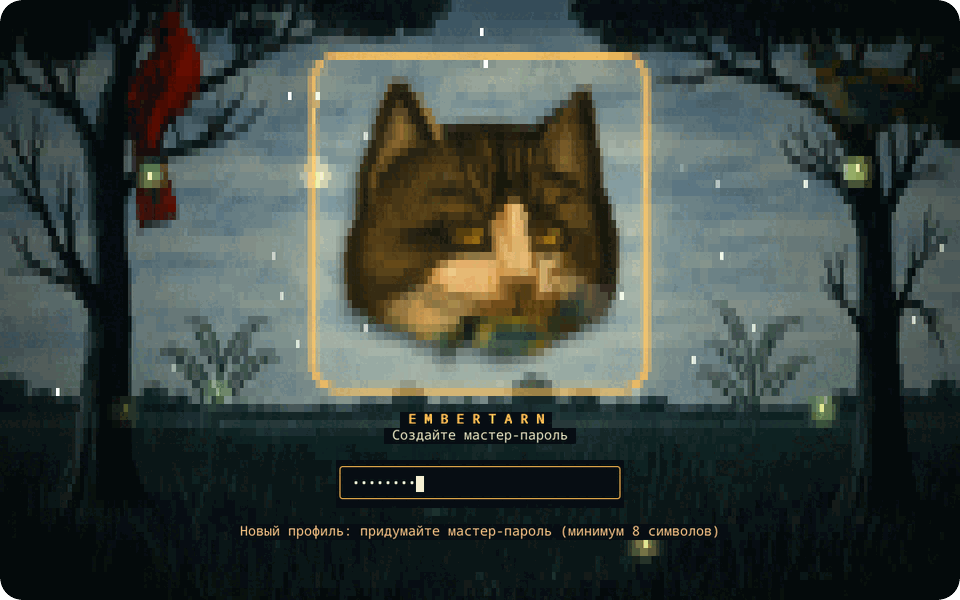</a>
      <h3><a href="https://github.com/TheSiriuss/embertarn">Embertarn</a></h3>
      <b>Go · peer-to-peer messenger for the terminal</b> 
      Messages go straight from peer to peer, end-to-end encrypted. Double Ratchet, XChaCha20-Poly1305, Kademlia DHT, QUIC with hole punching, voice and colour video, all drawn in a terminal.
    </td>
    <td width="50%" valign="top">
      <a href="https://github.com/TheSiriuss/chess-rt">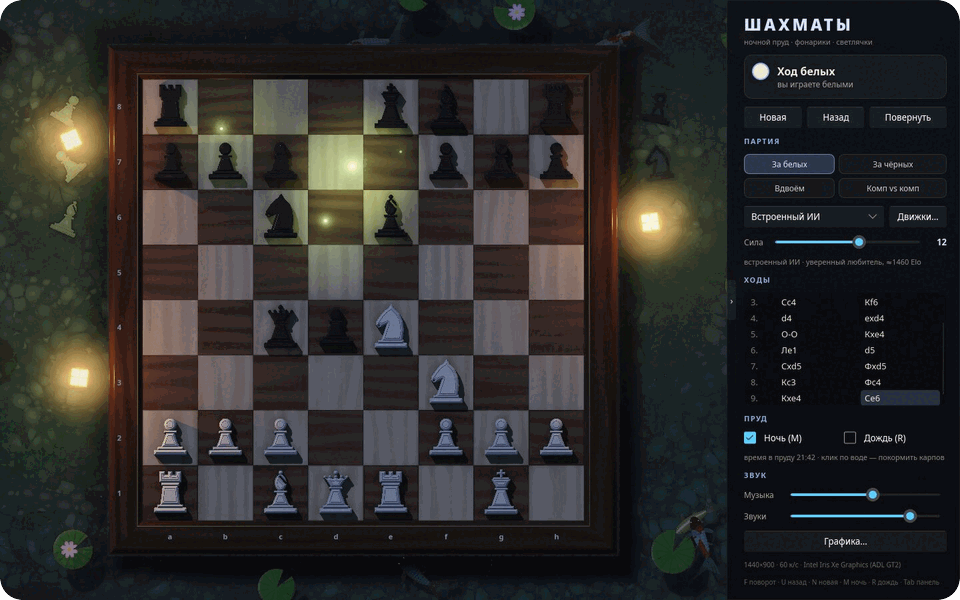</a>
      <h3><a href="https://github.com/TheSiriuss/chess-rt">chess-rt</a></h3>
      <b>Rust · Slint · GLSL · chess on a koi pond</b> 
      The whole scene is one ray-traced fragment shader: soft shadows, water caustics, koi, lanterns, rain and lightning. Plays against Stockfish and other UCI engines.
    </td>
  </tr>
  <tr>
    <td width="50%" valign="top">
      <a href="https://github.com/TheSiriuss/refind-cat">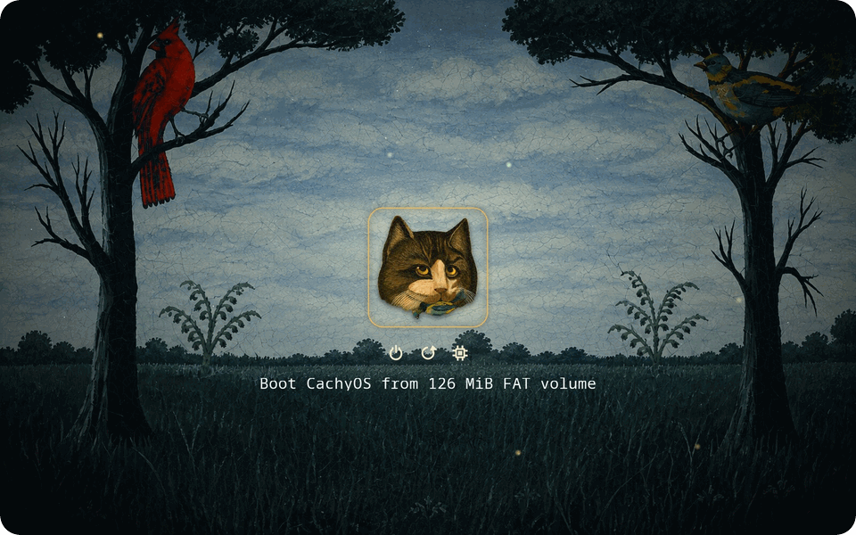</a>
      <h3><a href="https://github.com/TheSiriuss/refind-cat">refind-cat</a></h3>
      <b>freestanding C · UEFI · an animated boot menu</b> 
      A 12 KB driver adds animation to rEFInd: a blinking cat, fireflies and twinkling stars painted into the framebuffer. Tested in QEMU with OVMF.
    </td>
    <td width="50%" valign="top">
      <a href="https://github.com/TheSiriuss/keyos-passphrase">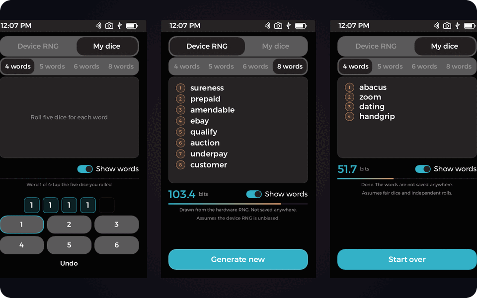</a>
      <h3><a href="https://github.com/TheSiriuss/keyos-passphrase">Passphrase for Passport Prime</a></h3>
      <b>Rust · Slint · diceware for a hardware wallet OS</b> 
      Words are drawn from the hardware RNG without bias and overwritten in memory afterwards. The screen covers them after 30 s and wipes after 120 s. The app works offline and keeps nothing on disk.
    </td>
  </tr>
</table>

 


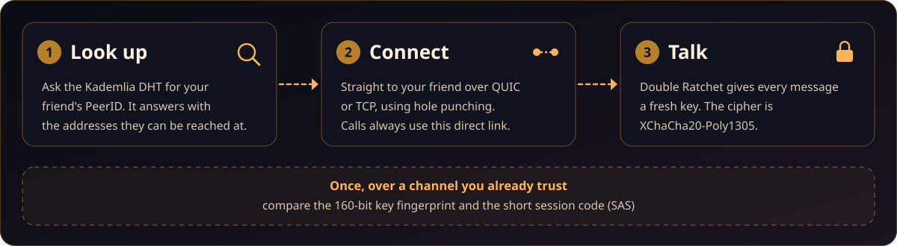

 


<table>
  <tr>
    <td width="25%" align="center" valign="top">
         
      <b>Applied cryptography</b> 
      <a href="https://github.com/TheSiriuss/embertarn">Embertarn</a>: Double Ratchet, XChaCha20-Poly1305, Argon2id. <a href="https://github.com/TheSiriuss/keyos-passphrase">Passphrase</a>: hardware RNG, wiped memory.
    </td>
    <td width="25%" align="center" valign="top">
       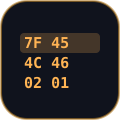  
      <b>Reverse engineering</b> 
      <a href="https://github.com/TheSiriuss/seiren-control">Seiren Control</a> re-implements a USB lighting protocol. <a href="https://github.com/TheSiriuss/emberrit-patcher">emberrit-patcher</a> and <a href="https://github.com/TheSiriuss/telegram-no-ads">telegram-no-ads</a> patch apps you supply.
    </td>
    <td width="25%" align="center" valign="top">
         
      <b>Audio DSP</b> 
      <a href="https://github.com/TheSiriuss/seiren-control">Seiren Control</a>: RNNoise, DeepFilterNet3, EQ, limiter, EBU R128 loudness, a virtual microphone.
    </td>
    <td width="25%" align="center" valign="top">
       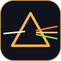  
      <b>Graphics</b> 
      <a href="https://github.com/TheSiriuss/chess-rt">chess-rt</a>, a ray-traced shader. <a href="https://github.com/TheSiriuss/refind-cat">refind-cat</a>, animation painted into the UEFI framebuffer.
    </td>
  </tr>
</table>

 



<b>More repositories</b>

 

| Repository | Language | What it is |
|:--|:--|:--|
| [embertarn](https://github.com/TheSiriuss/embertarn) | Go | Decentralised peer-to-peer messenger for the terminal |
| [chess-rt](https://github.com/TheSiriuss/chess-rt) | Rust | Chess on a raft in a koi pond, one ray-traced fragment shader |
| [seiren-control](https://github.com/TheSiriuss/seiren-control) | Rust | Linux control panel for the Razer Seiren V3 Chroma: lighting, recording, noise suppression, virtual mic |
| [keyos-passphrase](https://github.com/TheSiriuss/keyos-passphrase) | Rust | Diceware passphrase generator for the Passport Prime |
| [AV33-client](https://github.com/TheSiriuss/AV33-client) | Rust | Portable VPN client for Windows and Linux |
| [refind-cat](https://github.com/TheSiriuss/refind-cat) | Python, C | Animated night-meadow theme for rEFInd |
| [emberrit-patcher](https://github.com/TheSiriuss/emberrit-patcher) | Python | Builds an ad-free Reddit client from the APK you supply |
| [telegram-no-ads](https://github.com/TheSiriuss/telegram-no-ads) | Shell | Patch for Telegram Desktop that removes sponsored messages |
| [term-reader](https://github.com/TheSiriuss/term-reader) | Go | Terminal reader |
| [ASCII-camera-python](https://github.com/TheSiriuss/ASCII-camera-python) | Python | Webcam picture as ASCII art |

 

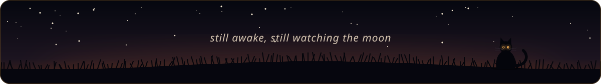
