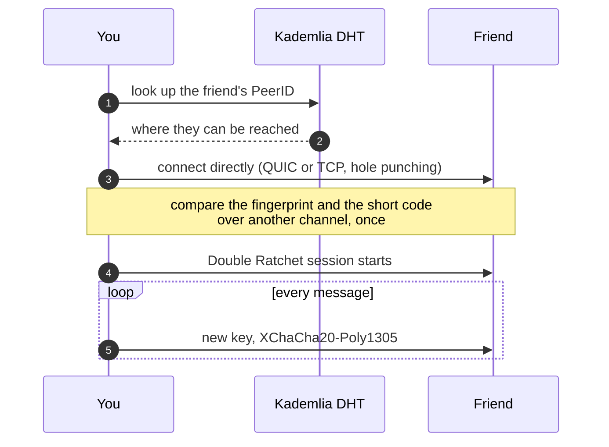

<div align="center">


<br>

<a href="https://github.com/TheSiriuss?tab=repositories&language=rust"></a>
<a href="https://github.com/TheSiriuss?tab=repositories&language=go"></a>
<a href="https://github.com/TheSiriuss?tab=repositories&language=python"></a>


<a href="https://t.me/NikitaGodfrey"></a>

<br><br>

<i>I build things that talk to each other privately,<br>and I like finding out how the things that guard them can be broken.</i>

</div>

<br>



## Featured

<table>
  <tr>
    <td width="50%" valign="top">
      <p align="center"><a href="https://github.com/TheSiriuss/embertarn"></a></p>
      <h3><a href="https://github.com/TheSiriuss/embertarn">Embertarn</a></h3>
      <sub><b>Go</b> · peer-to-peer messenger for the terminal</sub><br>
      No servers, no accounts. Double Ratchet, XChaCha20-Poly1305, Kademlia DHT, QUIC with hole punching, voice and colour video, all drawn in a terminal.
    </td>
    <td width="50%" valign="top">
      <p align="center"><a href="https://github.com/TheSiriuss/chess-rt"></a></p>
      <h3><a href="https://github.com/TheSiriuss/chess-rt">chess-rt</a></h3>
      <sub><b>Rust</b> · Slint · GLSL · chess on a koi pond</sub><br>
      The whole scene is one ray-traced fragment shader: soft shadows, water caustics, koi, lanterns, rain and lightning. Plays against Stockfish and other UCI engines.
    </td>
  </tr>
  <tr>
    <td width="50%" valign="top">
      <p align="center"><a href="https://github.com/TheSiriuss/refind-cat"></a></p>
      <h3><a href="https://github.com/TheSiriuss/refind-cat">refind-cat</a></h3>
      <sub><b>freestanding C</b> · UEFI · an animated boot menu</sub><br>
      rEFInd has no animation, so a 12 KB driver paints a blinking cat, fireflies and stars straight into the framebuffer. Tested in QEMU with OVMF.
    </td>
    <td width="50%" valign="top">
      <p align="center"><a href="https://github.com/TheSiriuss/keyos-passphrase"></a></p>
      <h3><a href="https://github.com/TheSiriuss/keyos-passphrase">Passphrase for Passport Prime</a></h3>
      <sub><b>Rust</b> · Slint · a diceware generator for a hardware wallet OS</sub><br>
      Unbiased draw from the hardware RNG, secrets overwritten with volatile zero stores, auto-cover after 30 s and wipe after 120 s. No network, nothing saved.
    </td>
  </tr>
</table>


## How Embertarn finds your friend




## House rules

| Rule | Where it shows |
|:--|:--|
| **No servers, no accounts.** You add a friend by exchanging one line. | [Embertarn](https://github.com/TheSiriuss/embertarn) |
| **No daemon.** One binary, one window. | [Seiren Control](https://github.com/TheSiriuss/seiren-control) |
| **No network, nothing saved.** And wipe what you held. | [Passphrase for Passport Prime](https://github.com/TheSiriuss/keyos-passphrase) |
| **Say what is not covered.** A "Not audited" line, a list of what it cannot wipe, what the tests cannot check. | [Embertarn](https://github.com/TheSiriuss/embertarn), [Passphrase](https://github.com/TheSiriuss/keyos-passphrase), [Seiren Control](https://github.com/TheSiriuss/seiren-control) |
| **You supply the binary.** Patchers publish the recipe, not the app. | [emberrit-patcher](https://github.com/TheSiriuss/emberrit-patcher), [telegram-no-ads](https://github.com/TheSiriuss/telegram-no-ads) |


## About, as a struct

```rust
const NIKITA: Person = Person {
    writes:   &["Rust", "Go", "Python", "C++"],
    speaks:   &["Русский", "English"],
    lives_in: "Budapest",
    likes:    &["applied crypto", "reverse engineering", "audio DSP", "shaders", "cats"],
    hunting:  "the gap between what a filter blocks and what it should",
    reach_me: "t.me/NikitaGodfrey",
};
```

**Languages across my public repositories**

```text
Rust    ████████░░░░░░░░░░░░░░░░  4
Go      ██████░░░░░░░░░░░░░░░░░░  3
Python  ██████░░░░░░░░░░░░░░░░░░  3
Shell   ████░░░░░░░░░░░░░░░░░░░░  2
```

<details>
<summary><b>More repositories</b></summary>

<br>

| Repository | Language | What it is |
|:--|:--|:--|
| [embertarn](https://github.com/TheSiriuss/embertarn) | Go | Decentralised peer-to-peer messenger for the terminal |
| [chess-rt](https://github.com/TheSiriuss/chess-rt) | Rust | Chess on a raft in a koi pond, one ray-traced fragment shader |
| [seiren-control](https://github.com/TheSiriuss/seiren-control) | Rust | Linux control panel for the Razer Seiren V3 Chroma: lighting, recording, noise suppression, virtual mic |
| [keyos-passphrase](https://github.com/TheSiriuss/keyos-passphrase) | Rust | Diceware passphrase generator for the Passport Prime |
| [AV33-client](https://github.com/TheSiriuss/AV33-client) | Rust | Portable VPN client for Windows and Linux |
| [refind-cat](https://github.com/TheSiriuss/refind-cat) | Python, C | Animated night-meadow theme for rEFInd |
| [emberrit-patcher](https://github.com/TheSiriuss/emberrit-patcher) | Python | Builds an ad-free Reddit client from the APK you supply |
| [telegram-no-ads](https://github.com/TheSiriuss/telegram-no-ads) | Shell | Patch for Telegram Desktop that removes sponsored messages |
| [term-reader](https://github.com/TheSiriuss/term-reader) | Go | Terminal reader |
| [ASCII-camera-python](https://github.com/TheSiriuss/ASCII-camera-python) | Python | Webcam picture as ASCII art |

</details>

<br>

<div align="center">

```text
  /\_/\
 ( o.o )   still awake. still watching the moon.
  > ^ <
```

</div>
